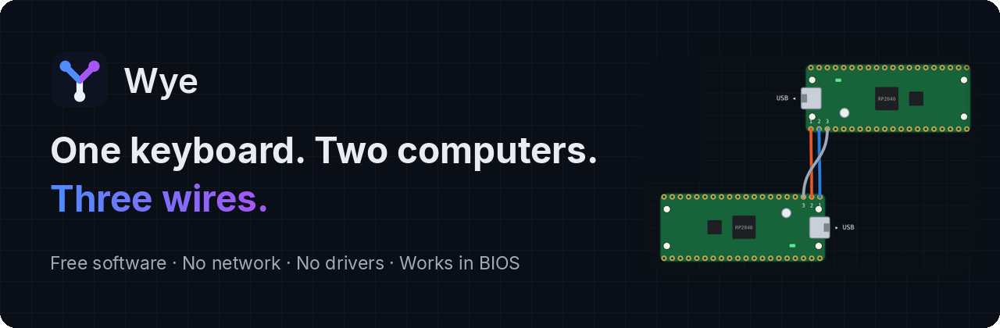
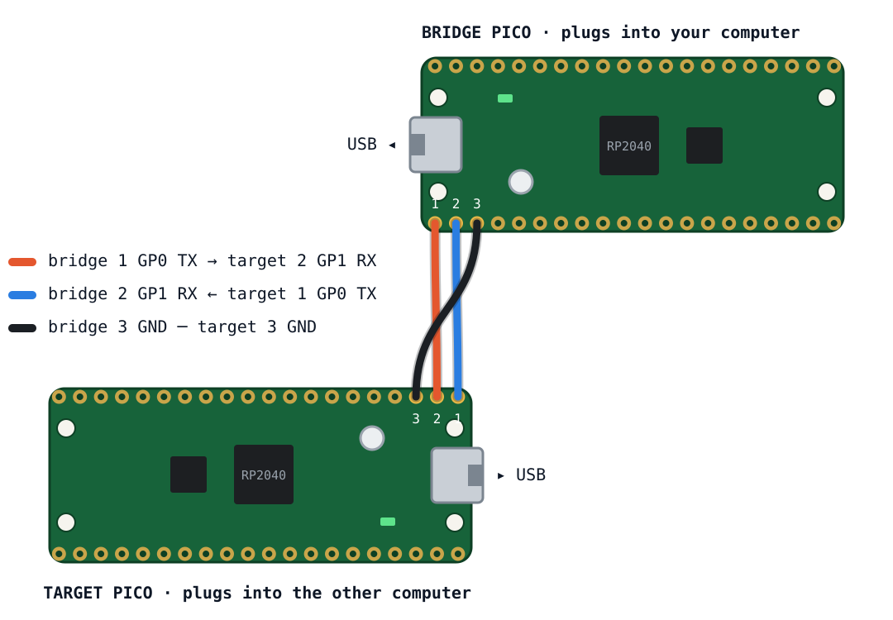

<p align="center"></p>

<p align="center">
  <a href="https://github.com/mkalmousli/wye/releases/latest"><b>Download</b></a> ·
  <a href="https://mkalmousli.github.io/wye/"><b>Website</b></a> ·
  <a href="https://mkalmousli.github.io/wye/#faq"><b>FAQ</b></a> ·
  <a href="https://github.com/mkalmousli/wye/issues/new/choose"><b>Report a problem</b></a>
</p>

# Wye

Use one keyboard and mouse on two computers, over a cable. Two Raspberry Pi
Picos bridge the machines: the *bridge* Pico plugs into the computer you sit
at, the *target* Pico into the other one, where it looks like an ordinary USB
keyboard, mouse, audio device and shared drive. No network, no drivers and
no software on the target, so it even works in BIOS.

A *wye* is a Y-shaped junction: one line in, two lines out.

Wye is free software under the [GNU GPL, version 3 or later](LICENSE). Every
feature is free for everyone, with no license keys, accounts or telemetry.

## What crosses the wire

| | |
| --- | --- |
| **Keyboard and mouse** | every key, media keys, five buttons, smooth scroll; keyboard lights stay in sync |
| **Sound** | hear the other computer and talk into its calls, both ways |
| **Shared folder** | shows up as a USB drive over there and syncs both ways |
| **Automation** | type the clipboard into anything, record and replay routines, Ctrl+Alt+Del on demand |
| **Your Picos** | give each board a name, colour and notes on the Picos page; they are stored on the board itself, so they go wherever it goes |
| **API** | let your own scripts and apps type and click over there directly, no hotkey needed; see [docs/API.md](docs/API.md) |

Out of the box only the keyboard and mouse are on. Turn the rest on under
**Devices** (sound, shared folder) and **Settings** (API) when you want them.

## Get started

You need two Raspberry Pi Picos, three jumper wires and two USB cables.

1. Install the app on the computer you sit at:

   **Linux or macOS:**

   ```sh
   curl -fsSL https://raw.githubusercontent.com/mkalmousli/wye/main/install.sh | sh
   ```

   **Windows (PowerShell):**

   ```powershell
   irm https://raw.githubusercontent.com/mkalmousli/wye/main/install.ps1 | iex
   ```

   Neither needs root or administrator rights. On Linux x64 and Windows they
   download the latest release and check its checksum. Where there's no release
   yet, `install.sh` builds from source, and tells you which tools it needs.

2. Connect pins **1→2, 2→1, 3→3** between the two Picos (TX, RX, ground):

   

3. Plug one Pico into each computer. The app installs and updates their firmware.
4. Open Wye from your app menu or by running `wye`, which returns to the prompt
   straight away and brings the window to the front if Wye is already running.
5. Press <kbd>F12</kbd> to switch. Press it again to come back.

Any device that accepts a USB keyboard can be the *other* computer: Macs,
tablets, Chromebooks, servers and kiosks.

## Layout

| Path | What |
| --- | --- |
| `app/` | the desktop app (core, per-OS platform layer, raylib UI) |
| `devcore/`, `proto/` | device logic and wire protocol shared by app, firmware and tests |
| `firmware/` | bridge and target Pico firmware (pico-sdk) |
| `tests/` | unit and simulation tests |
| `tools/build/` | the build tool, bundled by `build.c` |
| `site/` | the website, deployed to GitHub Pages |
| `install.sh`, `install.ps1` | the one-command installers |
| `keys/` | the public key that verifies updates (private `*.key` files never get committed) |

## Build

Everything is built by `build.c`, a small C program that runs itself - no
make, and CMake only for the firmware because the pico-sdk needs it:

```sh
./build.c firmware        # both Picos -> out/firmware/*.uf2 (needs the pico-sdk)
./build.c                 # the app    -> out/<os>/wye, firmware embedded
./build.c tests           # build and run the tests
./build.c install         # install the desktop app for this user
./build.c uninstall       # remove it again
./build.c --target=windows  # cross-build Wye.exe with mingw-w64
./build.c help            # everything else
```

On Windows without a POSIX shell: `gcc -o build.exe build.c && build.exe`.

On Debian or Ubuntu, install the build dependencies with:

```sh
sudo apt-get install build-essential libx11-dev libxrandr-dev libxi-dev libxinerama-dev libxcursor-dev libgl-dev
# firmware:
sudo apt-get install cmake ninja-build gcc-arm-none-eabi libnewlib-arm-none-eabi libstdc++-arm-none-eabi-newlib
git clone --depth 1 --branch 2.1.1 --recurse-submodules --shallow-submodules https://github.com/raspberrypi/pico-sdk.git
./build.c firmware --pico-sdk=pico-sdk
```

`install` puts the app where your desktop finds it, without root:

- **Linux:** `~/.local/bin/wye`, launcher and icons under `~/.local/share`
  (`--prefix=/usr/local` with sudo for all users). On first launch the app
  offers to set up device permissions.
- **macOS:** `~/Applications/Wye.app`.
- **Windows:** `%LOCALAPPDATA%\Programs\Wye` and a Start menu shortcut.

`uninstall` removes those files (on Linux also the login item); settings stay.

## Releases

Push a `v*` tag; `.github/workflows/release.yml` builds every platform, signs
`latest.json` with the release key and publishes a GitHub release, which the
in-app updater reads.

The workflow needs a `RELEASE_SIGNING_KEY` repository secret holding the
contents of the private key that matches `keys/release.pub`. To publish your
own fork, generate a key pair and point `WYE_UPDATE_URL` in `app/core/product.h`
at your releases:

```sh
out/linux/wye --release-keygen keys release   # keys/release.key stays private
```

## Contributing

See [CONTRIBUTING.md](CONTRIBUTING.md). Security problems go through
[SECURITY](.github/SECURITY.md), not public issues.

## License

Copyright (C) 2026 Wye contributors. Wye is licensed under the
[GNU General Public License, version 3 or later](LICENSE). Bundled components
keep their own licenses; see [THIRD_PARTY_NOTICES.md](THIRD_PARTY_NOTICES.md).
